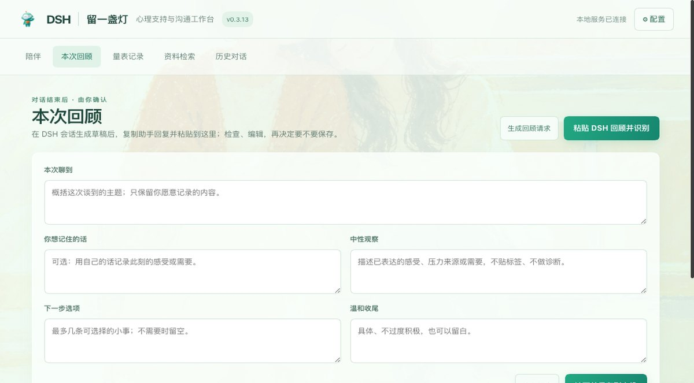
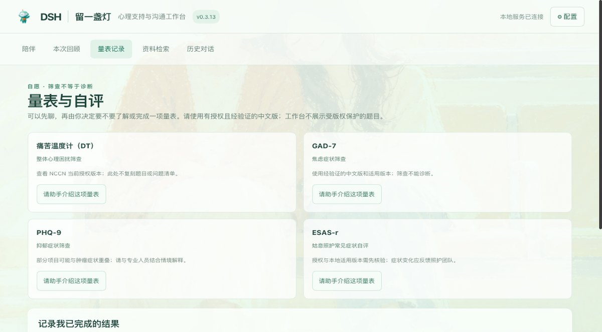
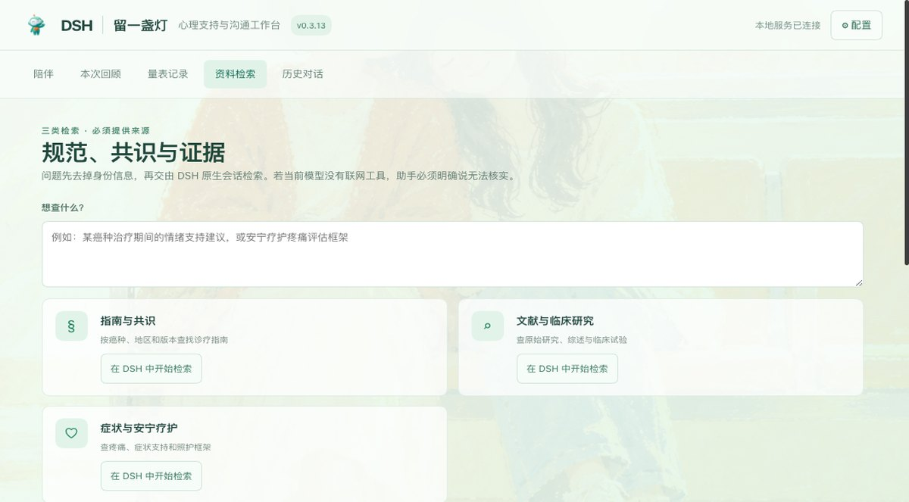
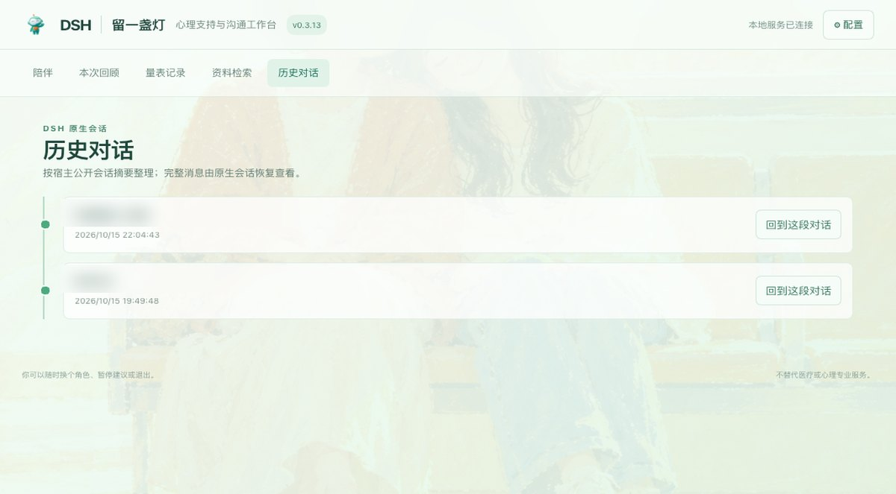
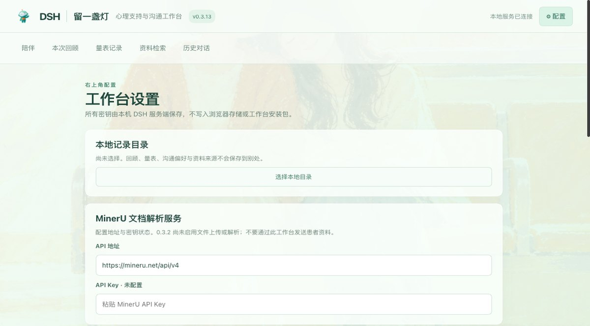
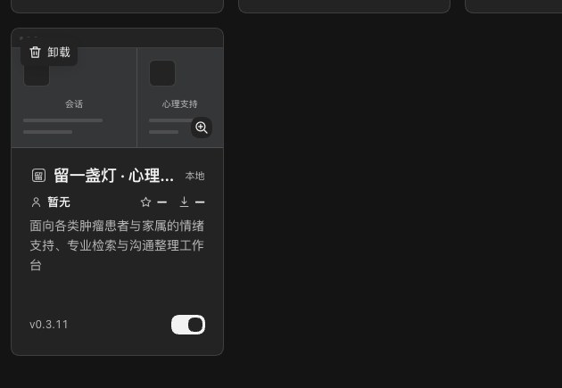

# 留一盏灯 · 癌症心理支持工作台

面向各类肿瘤患者与家属的 DSH Desktop 心理支持与沟通工作台。当前版本 **0.3.14**。

> The first DSH workbench dedicated to supporting the emotional and psychological well-being of people living with cancer and their caregivers.

它不是一个"AI 心理医生"。它做的是把**陪伴入口、对话后整理、已经做过的量表记录、专业资料检索、历史会话**收在一处，让情绪支持和沟通整理少一点门槛；涉及病情、治疗、疼痛和用药的问题，一律交回你真实世界里的临床团队。

- [产品规格](./SPEC.md)
- [UI/交互与安全设计](./docs/DESIGN.md)
- [DSH Desktop 集成问题与修复经验](./docs/DSH-Desktop-集成问题与修复经验.md)
- [检索能力包与记忆设计](./docs/WB-技能与记忆方案.md)
- [开发日志](./docs/开发日志.md)
- [独立 UI 预览](./docs/ui-preview.html)

## 界面

### 陪伴首页 · 六个角色


六个角色是**明确可见的用户提示模板**，不是系统提示词，也不是自定义 Agent 预设：

| 角色 | 面向 | 一句话 |
| --- | --- | --- |
| 新确诊陪伴 | 患者与家属 | 先不急着想明白。我们可以先把最担心的一件事说出来。 |
| 治疗与照护同行 | 治疗中的患者与照护者 | 崩溃、修复、前行，不必按顺序来。 |
| 安宁疗护陪伴 | 患者、家属与照护者 | 想要舒服一点、想说的话，都可以慢慢讲。 |
| 哀伤同行 | 正在经历失去的人 | 你不必照着谁的时间表过日子。 |
| 日常喘息与轻松聊 | 患者与家属 | 今天先不聊治疗。要不要说说猫狗？ |
| 亲戚吐槽与边界练习 | 患者与家属 | 来吐槽让你为难的话。等你愿意，再想怎么回应。 |

### 本次回顾 · 对话结束后由你确认



### 量表记录 · 只记录你自报的结果



### 资料检索 · 三类检索能力包



### 历史对话 · 本工作台拥有的原生会话



### 配置 · 记录目录与检索服务



### 在本机 DSH Desktop 的「已安装的工作台」中



### 换角色时的漂移提醒（0.3.12 新增）

角色设定只在**新建会话**时写一次草稿，所以换角色不会自动改写正在进行的这段对话。界面会明确提示这件事，并给一个按钮，由你决定要不要把新角色设定发进去：


不点也没关系——它只是提醒，不是自动注入。

## 功能概要

**陪伴** — 选角色、选或写一个此刻最想聊的话题，工作台把它整理成一段中文提示词写进 DSH 原生会话的输入框草稿，由你核对后自己发送。对话本身完全由 DSH 原生会话和你配置的模型承载，工作台不读对话正文。

**本次回顾** — 两种做法，都要你确认后才落盘：

- **读取这段会话**：工作台通过服务端公开的 `ctx.sessionQuery` 只读地读这段属于本工作台的会话，整理成五个字段的草稿（本次聊到 / 你想记住的话 / 中性观察 / 下一步选项 / 温和收尾）。只做搬运不做心理推断：前两段来自你说过的话，后三段留空等你写。
- **手动粘贴**：在原生会话里让助手按格式输出，自己复制粘贴到文本框里识别。

之所以保留手动粘贴，是因为 DSH Desktop 主进程的权限白名单只放行剪贴板**写入**，`navigator.clipboard.readText()` 在这台宿主上一定被拒（`Read permission denied`），工作台没法替你读系统剪贴板。

无论哪种方式，草稿都只是草稿：你检查、编辑、明确认可之后才会写入本地记录文件。它是本机沟通便笺，不是心理或临床评价。

**量表记录** — 覆盖痛苦温度计（DT）、GAD-7、PHQ-9、ESAS-r。工作台提示用途和授权边界，**不展示受版权保护的题目、不自动计分、不做解释**，只记录你已经完成并愿意保存的结果。筛查不等于诊断。

**资料检索** — 三项可复用检索能力包（肿瘤指南与共识 / 肿瘤文献与临床研究 / 安宁疗护、癌痛与症状支持）。可以只把检索请求写进 DSH 会话让模型自己查，也可以在明确同意后调用你已配置的 KNOWS 服务。所有结果必须带来源。

**历史对话** — 按宿主公开的会话元数据形成时间轴，点击回到那段原生会话；完整内容始终由 DSH 原生会话显示。

想重新开始时有「新开一段对话」：它走宿主的 `service.newSession(工作区)`，会新建一个属于本工作台的会话，**不会带上旧对话的上下文**。（注意不要用 `newWorkspaceSession()`——那个每次都会弹系统目录选择器；只有在完全没有工作区时才会走到它。）

**本地记忆** — 结构化回顾、量表记录、你自填的沟通偏好和明确保存的资料来源元数据，写入你选择的目录下的 `cancer-psych-support-memory.json`（可导出、可带走）。插件服务端配置与密钥单独保存在 DSH 服务数据目录，**不写进浏览器存储或安装包**。

## 边界与安全

- 不提供诊断、治疗、用药建议或心理治疗；不预测预后，不贴标签。
- 出现急剧加重的症状，或即时自伤 / 自杀 / 暴力风险，暂停角色语气，优先建议联系当地急救、就近急诊或可信任的人陪同。工作台不监测、不自动通知、不假称已联系任何人。
- 角色是可见的提示模板，不是系统提示词，也不创建自定义 Agent 预设。模型、工具权限和完整对话都由 DSH 管理。
- 仓库不含真实患者资料、真实会话或密钥；`data/mock/` 下的角色与对话均为虚构设计示例。

## 角色风格是怎么传给模型的

选中角色后，工作台把它拼成一段中文提示词写进**原生会话输入框的草稿**（提示词源码在 `src/prompt.mjs`，构建时内联进客户端）：

```
接下来这段时间，请你以「亲戚吐槽与边界练习」的身份陪我说话。

【怎么说话】              ← 六个角色共用的陪伴准则，排在最前面
1. 先在场，再谈别的。……不要立刻给建议、方案、话术或步骤。
2. 不追问创伤细节。不要问「什么时候走的」「确诊多久了」「几期」……
3. 一次只做一件事。通常一次只问一个问题……
4. 话要短。一般 2–4 句。
5. 不用咨询腔。……
6. 允许脏话、气愤、矛盾、反复和不想好起来。
7. 对方说你哪里做得不好时，直接承认，不辩解。
8. 不拿「我懂你」当开场白……
9. 直接说话。不输出括号里的舞台指示，不写「建议一/建议二」式分点。

【对方想找同伴时】        ← 只在对方主动提到孤单、想找病友时触发
【这个角色的语气】先站在用户这边把人接住，允许骂、允许爽。不要说「其实他们也是关心你」。……
【这个角色的边界】不攻击受保护身份、不泄露隐私、不煽动报复或骚扰。
【关于病情】不主动谈病种、分期或生存率，只接住这些处境里的感受。
【身份与禁忌】不假装是人类、不承诺绝对保密、不拿统计数字回应……

【我这会儿想说的】……
【我自己写的沟通偏好（请尊重，也可以问我是否仍然适用）】……
【仍然要守的安全底线，优先级高于上面的语气和边界】……
```

需要知道四件事：

1. 它是一条**用户消息**，不是系统提示词。所以需要你点发送才会真正进入上下文——这正是"草稿由用户确认"的设计，不是自动注入。
2. 它只在**新建会话**（"开始陪伴" → "进入陪伴"）时写入一次。已经拥有会话时按钮变成"继续这段对话"，不重复写草稿。
3. 之后的多轮对话靠 DSH 会话自己的上下文延续，没有独立的角色系统提示，长时间对话后风格可能漂移。
4. 换角色**不会**自动改写这段会话。选中新角色后界面会提示，并给一个「把新角色设定发进这段对话」按钮——由你决定是否重发；会话区工具栏也有「重发角色设定」，用来在风格漂移时把角色说明再写一遍。

**同样的道理：这段提示词是可以直接改的。** 它不是藏在插件里的黑盒——源码在 `src/prompt.mjs`，改完 `npm run build` 重新打包安装即可。写在「我自己写的沟通偏好」里的内容也会一起发出去。

也就是说：**"角色"是一段可见、可编辑、由你发送的提示词模板**，模型的回答由它自己按这段提示理解——工作台不假装拥有一个独立的角色人格，也不替你决定发送什么。

### 为什么提示词里有那些「怎么说话」

0.3.12 之前，注入的提示词只有 413 字，沟通方式只有一句"先承接情绪"，而 SPEC 里每个角色的"主要边界"从未进入提示词。真实测试里模型因此在吐槽场景中：还没听完就给"怎么挡回去"的话术、追问了"他是什么时候走的"这类创伤细节、并长篇分析关系。表现更像一个急于解决问题的通用助手。

现在把陪伴准则显式列在提示词最前面，并补上每个角色的 `voice`（语气）和 `boundary`（边界，与 SPEC §3 逐字一致）。`test/prompt-contract.test.mjs` 锁定这三点，防止回归。

后续又参考了 `prompt_template.md` 里的专业框架，但只吸收了能保护当事人的部分：空泛共情开场白（"我完全理解您的…"）被封掉，因为准则 1 要求说清具体的那件事；按癌种讲生存率的段落没有采用，因为它和安全底线里"不预测预后、不引用统计数字"直接冲突；同伴支持模块去掉了具体联系方式和入群话术，改成不宣称有渠道可介绍、转问医疗团队或医务社工。

**这仍然只能约束风格倾向，不能保证效果。** 模型的沟通质量取决于你在 DSH 里配置的模型本身；工作台能做的只是把要求写清楚、写具体、放在它一定会读到的地方。

## 开发

需要 Node.js 22+。

```sh
npm run build
npm run check
npm pack --dry-run
```

`npm run build` 把 `assets/` 里的插画转成 data URI、把 `src/prompt.mjs` 内联成模块，一起注入 `src/client.js` 的占位符，产出**已构建的单文件客户端** `lib/client.js` 和独立预览 `docs/ui-preview.html`。Desktop 不会替你构建，所以 `lib/client.js` 必须提交。占位符没替换干净时构建会直接失败，不产出半成品。`npm run check` 包含语法检查和单元测试（本地存储、认可保存、密钥隔离、数据路径、KNOWS URL 组装、v1 记忆升级、角色提示词契约）。

## 安装到 DSH Desktop

包同时是 npm 包、DSH 插件 bundle 和 Desktop 工作台。安装用官方 CLI 的 pnpm 透传入口：

```sh
npm pack
dsh plugin --profile web add ./dsh-cancer-psych-support-workbench-0.3.14.tgz
```

安装后**完整退出并重开 DSH Desktop**（不是关窗口）。重启后在左侧模式切换器里就能看到「留一盏灯 · 心理支持」。

两个已知的 pnpm 陷阱：

- **同版本重装会静默短路。** `pnpm add file:<tgz>` 在版本号没变时会打印 `Already up to date` 却不替换物理文件，于是重启后仍然加载旧产物。改完代码要重新出包时，先 `pnpm remove` 再 `pnpm add`，或直接升版本号。
- **pnpm 会剪掉 generation 投影链接。** Desktop 的 pnpm 包装器在运行前会把 `dsh.desktop.generationProjection.plugins` 里的包临时从 manifest 中摘掉，pnpm 于是把这些链接当成多余项删掉，运行后只 restore manifest、不重建 `node_modules`。若 `dsh --profile web --dump-config` 开始报 `cannot resolve profile bundle "..."`，用官方投影模块重建，不要手改 manifest：

  ```js
  import { exposeMissingGenerationLinks } from '<asar>/node_modules/dsh-desktop-market-installer/generations/projection.mjs'
  await exposeMissingGenerationLinks(process.env.DSH_HOME, 'web')
  ```

## 已知宿主接口陷阱：`service.ownsSession()` 会抛错

宿主的 `desktopWorkbenches` 服务在 `ownsSession(sessionId)` / `isActive()` 内部会读取**该服务自身绑定**的 Cordis fiber 名称（`this.ctx.fiber.entry.options.name`）：

```js
sourcePackage() {
  const source = this.ctx.fiber?.entry?.options?.name
  if (typeof source !== 'string' || !source.trim() || source === 'dsh-desktop-workbenches') {
    throw new Error('Workbench registration requires a client package entry name.')
  }
  return source
}
```

注册时没有问题：工作台是通过 `ctx.desktopWorkbenches` 这个 Cordis 追踪代理访问服务的，读 `.ctx` 会被重绑到**调用方**的 fiber，所以拿到的是我们自己的包名。问题出在渲染：宿主渲染业务面板时传的是**原始 service 实例**（`h(item.Component, { service, entry, ... })`），其 `this.ctx` 固定指向宿主自己的 fiber，于是名称等于宿主包名 `dsh-desktop-workbenches`，命中守卫抛错，整页渲染失败。

这个错误与本插件的包名、`__ModuleLoader__.load({ id })` 或 `package.json` 无关——本包这三项都是正确的。本包在 `src/client.js` 里用局部包装 + 按宿主自己的判据回退来兜住它：

```js
const ownsSession = (id) => {
  if (!id) return false
  try { if (service?.ownsSession?.(id) === true) return true; if (service?.ownsSession) return false } catch {}
  try { return service?.state?.sessionBindings?.[id] === entry?.id } catch { return false }
}
```

注意**不能简单写成 `catch { return false }`**：那会让历史会话永远不被归属，每次都要求你新建工作区。回退判据 `state.sessionBindings[id] === entry.id` 与宿主渲染路径自己用的完全一致。宿主端修复前，任何直接调用 `ownsSession()` / `isActive()` 且不做容错的工作台都会在渲染时整页失败。

## 素材

六角色人物为透明背景的女性陪伴插画，蓝发角色采用年轻丸子头造型；小胰宝 logo 和暖橙陪伴插画保存在 `assets/`。

## 许可

MIT，见 [LICENSE](./LICENSE)。
